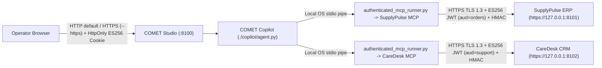

# COMET × Synapse — Architecture, Security & Verification Report

**Event:** 2nd Brain Labs × Geek Room Vibe-a-thon  
**Track Selected:** **Problem Statement 3 — *A copilot that works across two systems*** (`Synapse Auto Mode` + Live `synapse build --discover`)

> [!IMPORTANT]
> Both MCP servers (`synapse_auto_server.py`) are generated externally by `@2ndbrainlabs-ai/synapse-cli` (`v0.1.9`) from two standalone Python FastAPI sample services (`SupplyPulse ERP` and `CareDesk CRM`) that contain zero MCP SDK imports or hand-written tool schemas. Backend-to-MCP HTTP traffic runs over CA-pinned `TLSv1.3` (`TLS_AES_256_GCM_SHA384`) with asymmetric `ES256` public-key JWT verification and per-service `HMAC-SHA256` anti-replay signatures.

---

## 1. Problem Statement, Concrete Scenarios & Scope Distinction

Enterprise operations teams lose critical SLA minutes correlating disconnected systems during freight disruptions:
- **System 1 — `SupplyPulse ERP` (`https://127.0.0.1:8101`)** ([`./services/orders_logistics_service/app.py`](./services/orders_logistics_service/app.py)): Purpose-built sample FastAPI logistics/ERP backend managing freight shipments, carrier delays, customer orders, ARR contract tiers, and regional warehouse stock — **with no visibility into customer support tickets or SLA timers.**
- **System 2 — `CareDesk CRM` (`https://127.0.0.1:8102`)** ([`./services/support_ticketing_service/app.py`](./services/support_ticketing_service/app.py)): Purpose-built sample FastAPI ticketing backend managing P1–P3 escalations, SLA breach countdowns, and ticket notes — **with no visibility into shipment delays or warehouse replacement stock.**

### Concrete Cross-System Operator Workflows Demonstrated

| Demo Scenario | Cross-System MCP Calls | Concrete Operational Insight / Action Produced |
| :--- | :--- | :--- |
| **1. Delayed Shipment Blast Radius (`SHP-402`)** | `get_shipment_details`, `get_orders_by_shipment`, `get_inventory_by_sku` (`SupplyPulse`) + `get_tickets_by_customer` (`CareDesk`) | Correlates a **54h customs hold** on `SHP-402` (**\$86,100** across 3 orders) with support state: flags **Apex BioLabs** (`ORD-7801`, \$48.5k) at **38m remaining on P1 SLA (`TCK-901`)** with 6 backup units ready in `WH-BLR-02`, AND uncovers **Vanguard Robotics** (`ORD-7804`, \$31.2k Enterprise, \$185k ARR) with **zero tickets filed** *(silent VIP churn risk)*. |
| **2. P1 Escalation × Live Warehouse Stock** | `get_tickets_by_priority("P1")` (`CareDesk`) + `get_order_by_id`, `get_shipment_details`, `get_inventory_by_sku` (`SupplyPulse`) | Audits all 3 open P1 tickets: confirms `TCK-901` (Apex BioLabs) and `TCK-902` (MedCore Diagnostics) have 100% replacement stock in nearest regional hubs (`WH-BLR-02`, `WH-HYD-01`), while flagging a **critical stockout** on `TCK-903` (**Orbit FinServe**, needs 2 `SKU-HSM-CARD` units, only 1 in `WH-MUM-01`). |
| **3. Proactive Silent-Impact Writeback** | `list_delayed_shipments`, `get_orders_by_shipment` (`SupplyPulse`) + `get_tickets_by_order`, `create_proactive_ticket` (`CareDesk`) | Finds delayed Enterprise orders lacking support coverage (`ORD-7804` Vanguard Robotics, `ORD-7812`/`SHP-409` corridors) and opens idempotent proactive P1 alert tickets (`TCK-905`) in `CareDesk`. |
| **4. Live `synapse build --discover` Reroute** | *Before:* 5 read tools → reports missing reroute capability.<br>*After `--discover`:* calls `expedite_reroute_shipment` (`SupplyPulse`) + `update_or_escalate_ticket` (`CareDesk`) | Dynamically discovers the newly added `POST /shipments/{shipment_id}/expedite-reroute` endpoint, dispatches `ORD-7801` & `ORD-7804` from `WH-BLR-02` on Air Waybill `AWB-AIR-402-99X`, queues `ORD-7809` for partial restock, and transitions `TCK-901` to `mitigated` in `CareDesk`. |

**What Synapse Generates vs. What Lives in the Sample Backends:**
- Unlike Track 1 (which freezes an existing third-party codebase), Track 3 evaluates cross-system reasoning plus live endpoint evolution (`synapse build --discover`). Following Page 3 of the Participant Guide (*"Small sample apps are fine for every track"*), we authored and hardened both sample FastAPI backends (`app.py`) with domain validation, idempotency, and authentication guards, while keeping **100% of MCP server generation** delegated to `@2ndbrainlabs-ai/synapse-cli`.

---

## 2. System Architecture, Selective Exposure & Per-Hop Transport



### Selective Endpoint Exposure (Synapse Best Practice)
Per Page 7 of the Participant Guide (*"Expose only what the agent needs. Fewer, well-named tools make agents more reliable, and it counts in judging"*), internal health, reset, and security-telemetry endpoints are deliberately excluded via `synapse build --auto --endpoints ...`:

| Codebase | Exposed MCP Tools (`synapse_auto_server.py`) | Excluded Internal Routes |
| :--- | :--- | :--- |
| **`orders_logistics_service`** ([`./services/orders_logistics_service/synapse_auto_server.py`](./services/orders_logistics_service/synapse_auto_server.py)) | `list_delayed_shipments`, `get_shipment_details`, `get_order_by_id`, `get_orders_by_shipment`, `get_inventory_by_sku` *(+ `expedite_reroute_shipment` added live via `synapse build --discover`)* | `GET /health`, `POST /internal/reset-demo-state`, `GET /internal/security-telemetry` |
| **`support_ticketing_service`** ([`./services/support_ticketing_service/synapse_auto_server.py`](./services/support_ticketing_service/synapse_auto_server.py)) | `list_all_open_tickets`, `get_tickets_by_customer`, `get_tickets_by_order`, `get_tickets_by_priority`, `get_ticket_by_id`, `create_proactive_ticket`, `update_or_escalate_ticket` | `GET /health`, `POST /internal/reset-demo-state`, `GET /internal/security-telemetry` |

### Per-Hop Transport & Trust Boundary Table

| Hop | Default Transport | Optional / Hardened Mode | Authentication & Integrity Control |
| :--- | :--- | :--- | :--- |
| **1. Browser ↔ Studio (`:8100`)** ([`./dashboard/server.py`](./dashboard/server.py)) | `http://127.0.0.1:8100` *(avoids self-signed browser cert warnings during live judging)* | `https://127.0.0.1:8100` via `python start_studio.py --https` *(enables `TLSv1.3` + `Secure` cookie attribute)* | `HttpOnly; SameSite=Strict` `ES256` Studio Session JWT + loopback `Origin` & `Host` CSRF/DNS-rebinding guards |
| **2. Copilot ↔ MCP Servers** ([`./copilot/mcp_bridge.py`](./copilot/mcp_bridge.py)) | Unencrypted OS anonymous kernel `stdio` pipes *(local parent-to-child IPC; never traverses a network socket)* | Process-isolated environment allowlist (`_SAFE_SUBPROCESS_ENV_KEYS`) | Only the parent Copilot process holds the pipe file descriptors; no listening TCP port exposed |
| **3. MCP Runners ↔ Backends (`:8101`, `:8102`)** ([`./security/authenticated_mcp_runner.py`](./security/authenticated_mcp_runner.py)) | **Always-on `HTTPS` (`TLSv1.3` · `TLS_AES_256_GCM_SHA384`)** | Strict RFC 5280 `VERIFY_X509_STRICT` CA pinning (`REQUESTS_CA_BUNDLE=./certs/comet_ca.pem`) | Asymmetric `ES256` Bearer JWT (`aud`-scoped, verified via public key only) + per-service `HMAC-SHA256` timestamp/nonce signature |

---

## 3. AI / Copilot Orchestration Layer & Hallucination Guardrails

`CometCopilot` ([`./copilot/agent.py`](./copilot/agent.py)) discovers tools dynamically via `session.list_tools()` across both MCP servers and supports two execution modes:

1. **Live LLM Tool-Calling Engine (`_run_llm_tool_loop`)**:
   - Activates automatically whenever an LLM key is present in `.env`, using a unified **OpenAI-compatible Chat Completions `/chat/completions` interface** across all supported providers:
     - **Groq** (`GROQ_API_KEY` → `https://api.groq.com/openai/v1`, default `llama-3.3-70b-versatile`)
     - **OpenAI** (`OPENAI_API_KEY` → `https://api.openai.com/v1`, default `gpt-4o-mini`)
     - **Google Gemini** (`GEMINI_API_KEY` / `GOOGLE_API_KEY` → routed via Google's official OpenAI-compatible endpoint `https://generativelanguage.googleapis.com/v1beta/openai`, default `gemini-2.5-flash`)
     - **OpenRouter** (`OPENROUTER_API_KEY` → `https://openrouter.ai/api/v1`, default `openai/gpt-4o-mini`)
   - Translates live MCP `inputSchema` objects into `tools` function definitions, dispatches independent tool calls concurrently via `asyncio.gather`, and bounds execution to at most 8 turns.
2. **Rule-Based Workflow Orchestrator — Offline / Zero-Key Fallback (`_run_deterministic_mcp_workflow`)**:
   - When no external LLM API key is configured (or if an upstream provider errors mid-demo), falls back to a deterministic, rule-based cross-system workflow orchestrator (not an LLM loop) so live demos remain 100% functional offline while still executing genuine JSON-RPC `CallToolRequest` calls through both Synapse MCP servers.

### Blind LLM Agent (BLA) Privacy-Preserving Architecture (`./security/blind_llm_guard.py`)
To prevent enterprise PII and confidential customer rosters from leaking to external LLM providers during cross-system reasoning, COMET implements **BLA (Blind LLM Agents)** via `BlindLLMVault`:
- **Outbound Blinding (`blind_payload` / `blind_text`)**: Intercepts every MCP JSON payload before LLM ingestion, replacing `customer_name`, `assigned_to`, emails, and phone numbers with deterministic session-keyed `HMAC-SHA256` pseudonyms (`[ORG_BLIND_XXXXXX]`, `[STAFF_BLIND_XXXXXX]`). Because hashing is deterministic within a session, `"Apex BioLabs Pvt Ltd"` from `SupplyPulse` and `"Apex BioLabs Pvt Ltd"` from `CareDesk` resolve to the **exact same blind token**, preserving cross-system relational joins while keeping the LLM 100% blind to real identities.
- **Writeback Argument Unblinding (`unblind_payload`)**: When the Blind LLM invokes a mutating MCP tool (e.g., `create_proactive_ticket(customer_name="[ORG_BLIND_A1F9]", ...)`), the local MCP boundary automatically restores `"Vanguard Robotics"` before calling `CareDesk`.
- **Auditable Studio Inspector**: Operators and judges can click **🕶️ View: Blind LLM Context (Zero-PII)** in the Studio header to toggle live between the blinded `[ORG_BLIND_*]` LLM view and the unblinded operator view.

### Four Guardrails Against LLM Hallucinations & Prompt Injection
- **Closed-World Tool Registry (`MultiSystemMCPBridge.call_tool`)**: Hallucinated tool names absent from `session.list_tools()` are caught and returned to the LLM as structured JSON error messages instead of raising unhandled exceptions.
- **JSON-Schema Parameter Allowlisting (`validate_tool_arguments` in [`./copilot/mcp_bridge.py`](./copilot/mcp_bridge.py))**: Validates every argument key against `inputSchema.properties`, rejecting hallucinated extra arguments (`hallucinated_param=True`) before any HTTP request is sent.
- **Path-Traversal & Malformed-JSON Guards**: Catches `json.JSONDecodeError` on malformed LLM `arguments` strings and enforces `^[A-Za-z0-9_-]{1,32}$` on path-interpolated IDs (`shipment_id`, `order_id`, `customer_id`, `ticket_id`, `sku`, `priority`), blocking `../internal/...` URL traversal.
- **Untrusted-Data Boundary & Server-Side Pydantic Validation**: System prompts mark ticket subjects/notes as untrusted data, reinforced by server-side Pydantic enums (`P1|P2|P3`, `open|mitigated|resolved`, `VALID_HUBS`).

---

## 4. Service Compartmentalization (`ES256`) & Explicit MCP Wrapper

Because all demo components run under one OS user on a single hackathon laptop, this design is **compartmentalized (Zero-Trust-modeled)** at the process and credential level rather than claiming multi-host physical isolation (in production, `Studio/Control Plane`, `SupplyPulse`, and `CareDesk` would run in separate containers/IAM principals with KMS/SPIFFE keys):

- **Asymmetric `ES256` Public-Key Verification ([`./security/auth_guard.py`](./security/auth_guard.py), [`./copilot/service_manager.py`](./copilot/service_manager.py))**: Only the control-plane process holds `ISSUER_PRIVATE_KEY_PEM`. `SupplyPulse` receives only `ISSUER_PUBLIC_KEY_PEM` + `SUPPLYPULSE_HMAC_SECRET`; `CareDesk` receives only `ISSUER_PUBLIC_KEY_PEM` + `CAREDESK_HMAC_SECRET`. Neither backend holds any JWT signing private key or peer HMAC secret, yet public-key verification still distinguishes genuine wrong-audience token replay (`403 CROSS_SERVICE_AUDIENCE_SPOOF`) from forged signatures (`401 TAMPERED_OR_FORGED_TOKEN`).
- **Explicit Auditable MCP Wrapper ([`./security/authenticated_mcp_runner.py`](./security/authenticated_mcp_runner.py))**: Replaces implicit `sitecustomize.py` hooks with an explicit CLI wrapper declared directly in [`./mcp_client_config.json`](./mcp_client_config.json) (`python ./security/authenticated_mcp_runner.py ./services/.../synapse_auto_server.py`), attaching `ScopedES256AndHMACAuth` and `REQUESTS_CA_BUNDLE` TLS verification to a pooled `requests.Session` while keeping `synapse_auto_server.py` untouched.

---

## 5. Controlled Live `--discover` Demo Harness & Split Latency Benchmarks

> [!NOTE]
> Runtime route injection ([`./copilot/live_discover.py`](./copilot/live_discover.py)) is strictly a **hackathon demonstration harness** automating the developer step in Problem Statement 3 (*"During the demo, add a new endpoint, rebuild with `synapse build --discover`, and show the agent using it straight away"*), and is gated behind `DEMO_HARNESS_ENABLED` (`0` disables `/api/live-discover/*` with `403 Forbidden`).

- **ERP-Layer Idempotency**: `SHIPMENTS[sid]["expedited_result"]` is stored inside `SupplyPulse ERP`'s own state lock (`_STATE_LOCK` in `orders_logistics_service/app.py`), returning `already_expedited: True` on repeated calls without double-deducting stock and rejecting `DELIVERED` shipments (`SHP-415`) with `409 Conflict`.
- **Drain-Then-Reload Coordination**: Studio's `_mutation_lock` ([`./dashboard/server.py`](./dashboard/server.py)) drains all in-flight `/api/ask` calls before writing `app.py` via atomic `os.replace`, running `synapse build --discover`, restarting `:8101` (`--timeout-graceful-shutdown 2`), polling `/openapi.json` until live, and reloading the `orders_logistics_service` MCP worker.

### Split Latency Benchmarks (MCP Transport vs. LLM Inference)

| Execution Mode | Measured Scope | Latency (8 Cross-System MCP Calls) |
| :--- | :--- | :--- |
| **Cold-Start Subprocess Baseline** *(pre-optimization)* | Spawning 2 fresh Python MCP subprocesses per request + sequential HTTP calls (`0` LLM calls) | `~3,200 – 3,800 ms` |
| **Warm MCP Transport Layer** *(Rule-Based Offline Orchestrator)* | Persistent `stdio` JSON-RPC + pooled `TLSv1.3` + `ES256` JWT + `HMAC-SHA256` across both servers (**`0.0 ms` LLM time**) | **`42.6 – 92.4 ms`** |
| **Live Cloud LLM Mode** *(Groq / OpenAI / Gemini / OpenRouter)* | `2–3` remote LLM tool-planning & synthesis round-trips **plus** the `~45–95 ms` MCP transport overhead above | Typically **`1,200 – 3,800 ms`** *(provider/model dependent)* |

---

## 6. Automated Verification Evidence (`32/32` Assertions Passed)

[`./test_security_and_latency.py`](./test_security_and_latency.py) verifies 32 assertions across 7 suites (path-traversal & JSON-schema hallucination rejection, subprocess secret isolation, Studio `ES256` session/CSRF/DNS-rebinding guards, `TLSv1.3` CA pinning, all false-auth/nonce-replay/429-lockout vectors, `DEMO_HARNESS_ENABLED=0` lock, live `synapse build --discover` + ERP idempotency, and Blind LLM Agent zero-PII tokenization/join/unblinding):

```text
[PASS] Suite 1: Path-traversal, JSON-Schema hallucination guard & env isolation (9 assertions)
[PASS] Suite 2: Studio ES256 session cookie, CSRF & DNS-rebinding guards (14 cumulative)
[PASS] Suite 3: Backend HTTPS (TLSv1.3 · TLS_AES_256_GCM_SHA384) & CA pinning (17 cumulative)
[PASS] Suite 4: ES256 public-key audience spoof, nonce replay & 429 lockout (21 cumulative)
[PASS] Suite 5: DEMO_HARNESS_ENABLED=0 blocks runtime route mutation (22 cumulative)
[PASS] Suite 6: MCP transport=44.0ms (LLM=0.0ms), live --discover & ERP idempotency (26 cumulative)
[PASS] Suite 7: Blind LLM Agent (BLA) zero-PII tokenization, cross-system join & writeback unblinding (32 cumulative)

SUMMARY: 32/32 assertions passed across 7 verification suites (0 failures).
```

---

## 7. Quickstart & Run Commands

```powershell
# 1. Start Interactive Web Studio (Loopback HTTP UI on :8100 + TLS 1.3 Backends on :8101/:8102)
.\.venv\Scripts\python.exe .\start_studio.py

# 2. Optional: Serve Browser-to-Studio UI over TLS 1.3 as well (https://127.0.0.1:8100)
.\.venv\Scripts\python.exe .\start_studio.py --https

# 3. Run Automated CLI Judge Demo (Prompts 1-2 + Before/After Live `synapse build --discover`)
.\.venv\Scripts\python.exe .\run_demo.py

# 4. Run 26-Assertion Security, Loophole & Latency Verification Suite
.\.venv\Scripts\python.exe .\test_security_and_latency.py
```

For external MCP clients (Claude Desktop, Cursor, Antigravity), paste [`./mcp_client_config.json`](./mcp_client_config.json) into `mcpServers`.
